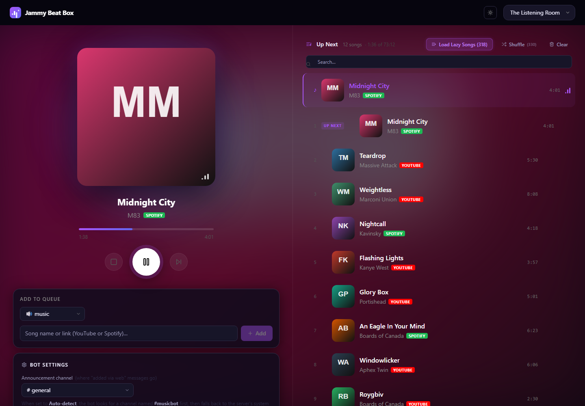
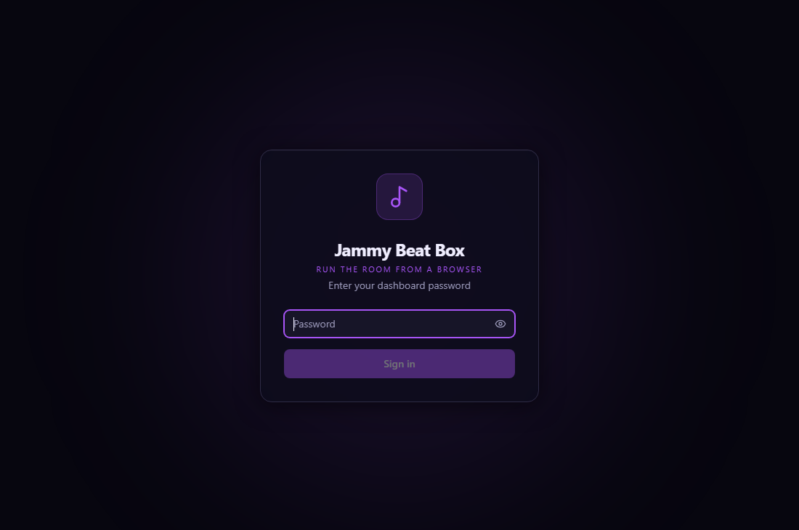
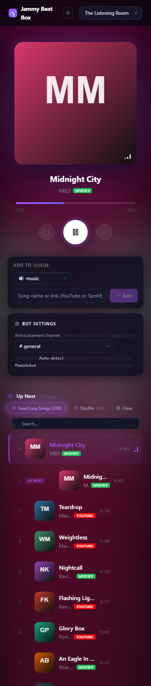
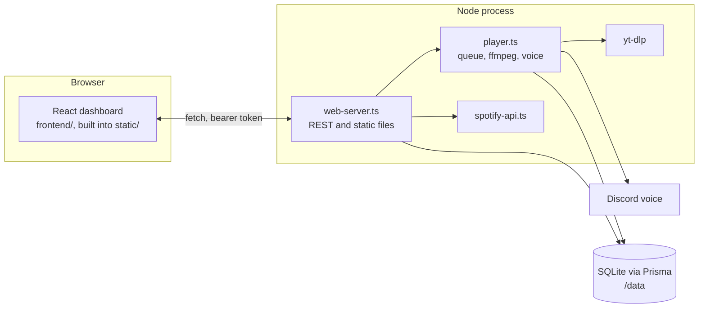
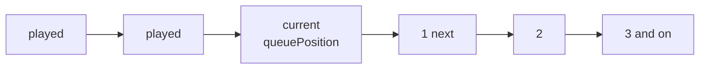
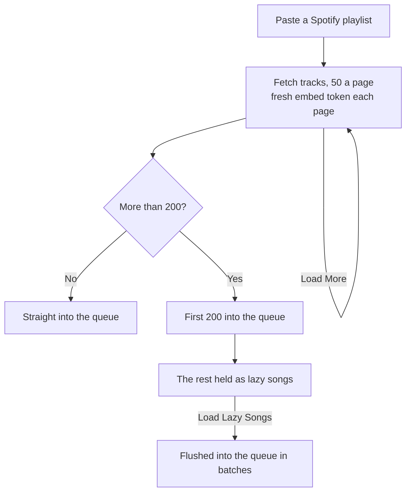
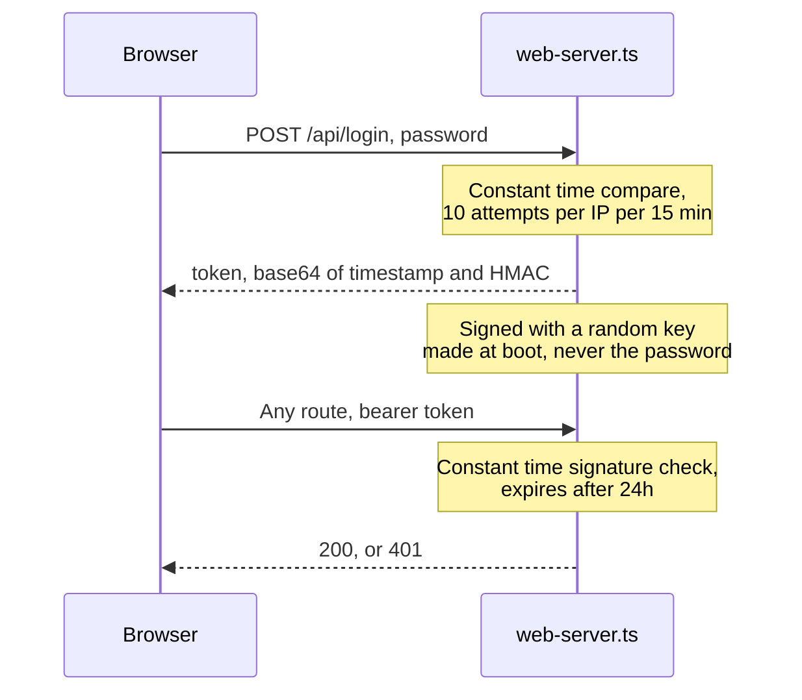

<h1 align="center">Jammy Beat Box</h1>
<p align="center"><strong>Run the room from a browser.</strong></p>
<p align="center">A self-hosted Discord music bot with a web dashboard. Paste a 500 track Spotify playlist, reorder it, and drive the room without typing a single slash command.</p>

<p align="center">
  
  
  
  
</p>

---

<p align="center">
  
</p>

<table>
<tr>
<td width="62%"></td>
<td width="38%"></td>
</tr>
<tr>
<td align="center"><sub>One password, no Discord OAuth round trip.</sub></td>
<td align="center"><sub>Stacks on a phone.</sub></td>
</tr>
</table>

<p align="center"><sub>Tracks shown are placeholder data, not a real queue.</sub></p>

---

## Credit where it is due

This is a fork of [museofficial/muse](https://github.com/museofficial/muse) by Max Isom, MIT licensed. Muse is the Discord bot, the voice plumbing, the slash commands, the caching and the Prisma schema. All of that is theirs and it is good. Their README is kept at [docs/UPSTREAM-README.md](docs/UPSTREAM-README.md).

What this fork adds is a **web dashboard** and the Spotify work needed to make large playlists usable. If you want the original bot, go upstream. If you want to run it from a browser, stay here.

## What this fork adds

| | |
|---|---|
| **Web dashboard** | React, Vite and Tailwind, served by the bot itself. Now playing, a reorderable queue, search, volume, seek, speed, EQ, crossfade and audio effects |
| **Big Spotify playlists** | A 500 track playlist no longer times out. The first 200 go into the queue, the rest wait as lazy songs and load on demand |
| **Album art that shows up** | Deezer backfills the artwork Spotify's embed endpoint withholds, prefetched in the background |
| **Load More** | Pulls the next batch with a fresh embed token each time, so a rate limit on page one does not kill the rest |
| **Auto DJ and a DJ deck** | Two decks, crossfade, and a hands-off mode |
| **Discord announcements** | The channel sees what the dashboard queued, so nobody wonders where the music came from |

---

## Run it

You need a Discord bot token. YouTube and Spotify keys are optional and unlock their respective sources.

```bash
cp .env.example .env     # fill in DISCORD_TOKEN and WEB_PASSWORD
docker compose up -d --build
```

The dashboard is on port 4000. Without `WEB_PASSWORD` set the web server never starts, and you get the plain Discord bot.

Locally, without Docker:

```bash
yarn install
yarn install:frontend
yarn build:frontend      # builds into static/, which the bot serves
yarn start
```

For frontend work, `cd frontend && npm run dev` runs Vite on 5173 and proxies `/api` to the bot on 4000.

---

## How it fits together



The dashboard is not a separate service. Vite builds into `static/`, and the same Node process that talks to Discord serves those files and the REST API.

### The queue is one list with a cursor

There is no separate history array. `queuePosition` points at the current song, everything behind it is history and everything ahead is up next. Every API index is **1-based and relative to the current song**, so position 1 is the next song, not the first one ever added.



### Why big playlists need two tiers

Spotify's embed endpoint rate limits hard, and queueing 500 songs at once means 500 yt-dlp resolutions. So a large add splits.



The stored offset advances by the **item count Spotify reports**, not by how many tracks survive filtering. Removed and local tracks are items too, so counting only the survivors makes the offset drift backwards and re-read the same pages forever.

### Auth

One shared password, no Discord OAuth. Good enough for a server of friends, and the parts that matter are not sloppy.



Tokens are signed with a key generated at boot, so a restart logs everyone out. That is deliberate. Signing with `WEB_PASSWORD` would let anyone holding one token brute force the password offline.

**If you put this on the internet**, set `WEB_TRUST_PROXY` to the number of proxies in front of it. Without it every request looks like it came from the proxy, so the rate limiter counts them all together and ten bad guesses lock out everybody.

---

## Configuration

Everything is an environment variable, and `.env.example` has the full list.

| Variable | Does |
|---|---|
| `DISCORD_TOKEN` | Required. Nothing runs without it |
| `WEB_PASSWORD` | Turns the dashboard on. Unset means Discord only |
| `WEB_PORT` | Dashboard port, 4000 by default |
| `WEB_TRUST_PROXY` | Hop count for a reverse proxy. Set it if the dashboard is public |
| `DISABLE_WEB_ANNOUNCEMENTS` | Stops the bot posting in Discord when the dashboard queues something |
| `SPOTIFY_CLIENT_ID`, `SPOTIFY_CLIENT_SECRET` | Spotify URL conversion |
| `YOUTUBE_API_KEY` | YouTube search and playlists |
| `CACHE_LIMIT` | Disk budget for cached audio, e.g. `2GB` |

---

## Changing things

| To change | Where |
|---|---|
| How many songs go in before the rest go lazy | `ACTIVE_LIMIT` in `src/services/web-server.ts` |
| How many tracks one Load More pulls | `BATCH` in the same file, kept at 100 because the embed token tolerates about two pages |
| How often missing album art is swept for | `thumbSweepInterval` in `src/services/player.ts` |
| How long the bot waits in an empty channel | `EMPTY_CHANNEL_TIMEOUT_SECONDS` in `src/events/voice-state-update.ts`, and it only fires when `leaveIfNoListeners` is on |
| Session length | `TOKEN_MAX_AGE_MS` in `src/services/web-server.ts` |
| Audio effects | `AUDIO_EFFECT_FILTERS` in `src/services/player.ts`, each entry a list of ffmpeg filter strings |

### Adding an API endpoint

1. Add the route in `src/services/web-server.ts`, behind the `auth` middleware. Everything except `/api/login` uses it.
2. Validate anything that becomes an array index with `isQueuePosition`. A bare `typeof x === 'number'` lets a negative through, and a negative index splices from the end of the queue.
3. Add the typed caller to `frontend/src/lib/api.ts`.
4. Call it from a component. State lives in `Dashboard.tsx`, which polls `/status` every 2 seconds and passes it down.

### Adding an audio effect

Add a key to `AudioEffect` and the matching ffmpeg filters to `AUDIO_EFFECT_FILTERS` in `src/services/player.ts`, then add the option to the effect control in the dashboard. The filter chain is rebuilt per track, so an effect applies from the next song rather than mid-stream.

---

## House rules

- **The frontend builds into `static/`.** It is not deployed separately and it has no server of its own.
- **Validate at the API boundary.** Player methods trust their arguments, so the route is where a bad index gets rejected.
- **Only settings and favourites are persisted.** The queue, positions and playlist context live in memory and are rebuilt on restart.
- **Upstream code stays upstream shaped.** Changes to muse's own files are kept small so pulling their fixes stays possible.

## Licence

MIT, inherited from [muse](https://github.com/museofficial/muse). Copyright (c) 2020 Max Isom. See [LICENSE](LICENSE).
